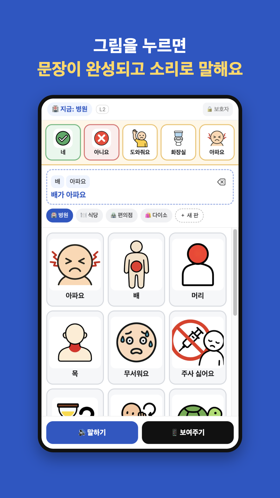
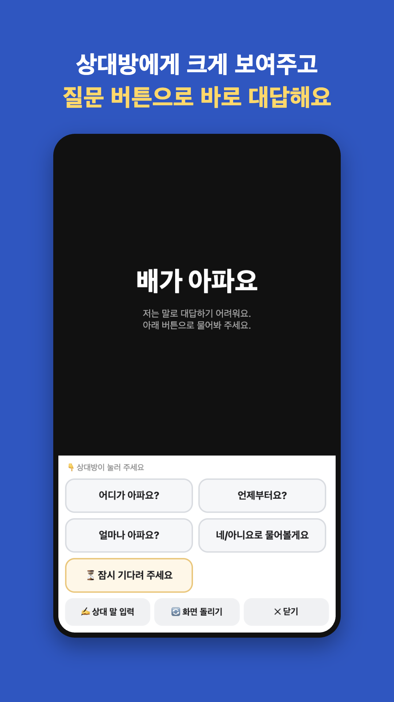
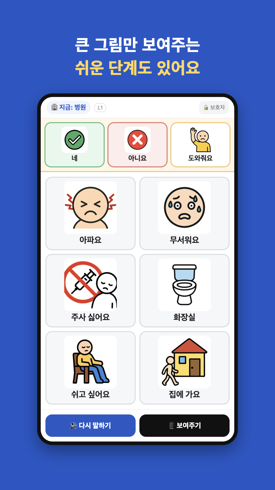
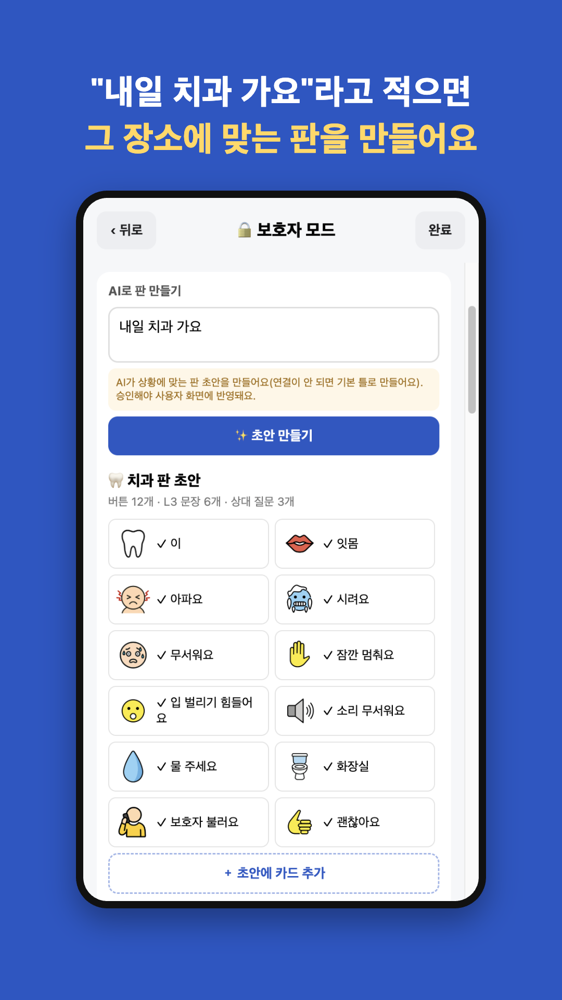
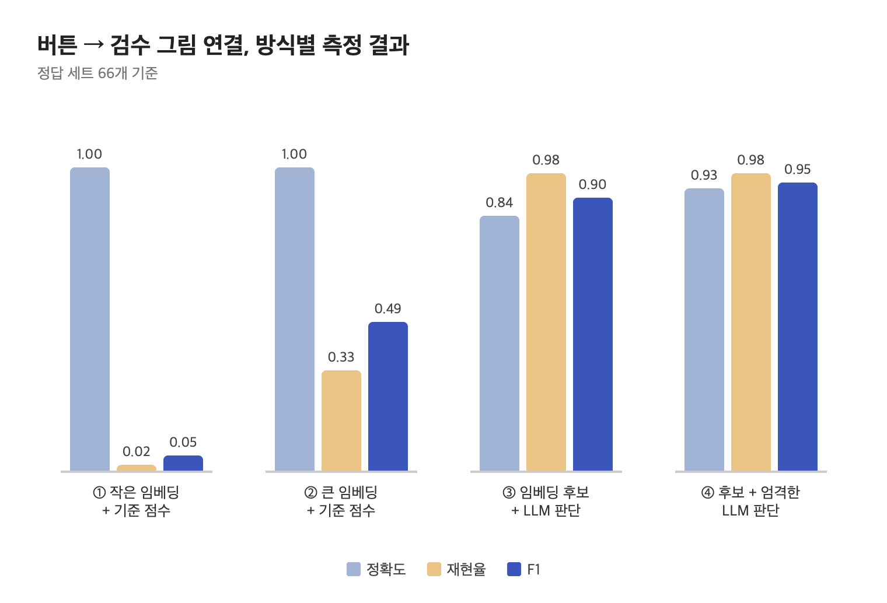

<p align="center"></p>

# 콕톡 (KokTok) - 그림으로 말하는 AAC

말하기가 어려운 아동·성인(언어장애, 발달장애 등)이 **그림 카드를 눌러 의사소통**하는 보완대체의사소통(AAC) 모바일 앱입니다.
1인 개발로 기획부터 디자인, 앱, 서버, AI 파이프라인, 배포, 스토어 출시 과정까지 진행했습니다.

- 상태: Google Play 비공개 테스트 중 (2026.10)
- 개발기: [LLM이랑 RAG 붙여본 기록](https://eun091696.tistory.com/23), [GitHub PR과 Actions로 CI 구축하기](https://eun091696.tistory.com/22)

| 문장 만들기 | 상대에게 보여주기 | 쉬운 단계(L1) | AI 판 만들기 |
|---|---|---|---|
|  |  |  |  |

## 주요 기능

- **누르면 바로 말하기**: 카드를 누르면 미리 생성한 음성(333문장)으로 재생, 무음 모드에서도 출력
- **한국어 조사 자동 처리**: `배` + `아파요` → "배가 아파요"
- **3단계 화면**: L1 그림 중심 / L2 그림+단어 조합 / L3 문장·직접 입력
- **장소별 판**: 병원·식당·편의점·다이소, 상단 핵심 버튼은 위치 고정
- **보여주기 화면**: 큰 글씨, 상대방이 누르는 질문 버튼 → 사용자 답 카드
- **보호자 모드(PIN)**: 카드 추가·수정·숨기기, 직접 찍은 사진 카드, **AI로 판 만들기**
- **개인정보 최소화**: 회원가입 없음, 데이터는 기기에만 저장. AI 기능 사용 시에만 입력 문장 전송

## AI 파이프라인

보호자가 "내일 치과 가요"처럼 상황을 적으면 그 장소에 맞는 판 초안을 만듭니다.

```
입력 검사(길이·개인정보 요청 차단) → 결과 캐시
 → RAG 검색: 상황과 가까운 기존 카드 20개 (임베딩)
 → LLM 판 생성 (gpt-5-mini, JSON Schema 강제)
 → 서버 규칙 검사 (어려운 단어·금지어 제거, 필수 버튼 보장, 조사 규칙)
 → 버튼별 검수 그림 연결 (임베딩 후보 5개 + LLM 판단)
 → 보호자가 확인한 버튼만 추가
```

설계 원칙: **LLM은 만들고, 지켜야 할 규칙은 코드가 지킨다.** 단계가 실패해도 앱은 기본 틀로 동작합니다.

### 측정하며 개선한 결과



| 항목 | 결과 |
|---|---|
| 그림 연결 (정답 세트 66개) | F1 **0.05 → 0.95** (임베딩 기준점수 → 임베딩 후보 + LLM 판단) |
| 판 생성 속도 | 약 25초 → **6~10초** (이름 일치 판단 생략, 추론량 최소화, 필수 규칙 코드로 보완) |
| 판 품질 평가 (24개 상황, LLM-as-a-Judge) | 생성 실패 0, 안전 경고 1 → 0, 어려운 단어 4.3% → 2.1% |
| 채점관 검증 | 사람 정답 대비 말하는 사람 판단 88%, 어려운 말 판단 96% 일치 |

평가 실행: `npm --prefix server run eval:match`, `npm --prefix server run eval:boards`

## 그림·음성 자산

- **픽토그램 55장**: 생성(gpt-image-1-mini) → 검수 → 등록 파이프라인 (`scripts/image-library`)
- **음성 333문장**: 오픈소스 온디바이스 TTS(Supertonic 3)로 미리 생성, 앞뒤 무음 제거 (`scripts/voice-library`)
- CI에서 그림·음성 누락 검사

## 기술 스택

| 영역 | 사용 기술 |
|---|---|
| 앱 | React Native, Expo SDK 57, TypeScript, expo-audio |
| 서버 | Node.js (외부 의존성 없음), Docker |
| AI | OpenAI Responses API (Structured Outputs), text-embedding-3-large, gpt-image-1-mini, Supertonic TTS |
| 인프라 | AWS Lightsail Containers (서울), GitHub Pages |
| CI/CD | GitHub Actions: 린트·타입·로직·서버 테스트(117개) / main 머지 시 서버 자동 배포 / EAS Build |

## 구조

```
src/
  screens/        Home(말하기) · Show(보여주기) · Guardian(보호자)
  components/     카드, 격자, 모달 등
  lib/            speech(음성), korean(조사), aiDraft(AI 판 요청), 그림·저장소
  state/          앱 상태
server/
  src/            boardGenerator(LLM) · retrieval(RAG) · imageJudge · dailyQuota · server
  eval/           정답 세트·평가 상황·측정 기록
  test/           자동 테스트
scripts/          그림·음성 라이브러리 생성, AWS 초기 설정
.github/workflows CI, 서버 배포
```

## 실행

```bash
npm install
npx expo start                 # Expo Go로 QR 스캔

npm run typecheck && npm run lint && npm run check:logic
npm --prefix server test       # 서버 테스트
```

서버를 직접 띄우려면 `server/.env.example`을 참고해 `OPENAI_API_KEY`를 설정합니다. 앱에는 API 키를 넣지 않습니다.

## 라이선스

© 2026 안창은 (ACE0916). All rights reserved.
포트폴리오 열람 목적으로 공개한 저장소입니다. 코드·그림·음성의 복제, 수정, 배포 및 상업적 이용을 허용하지 않습니다.
